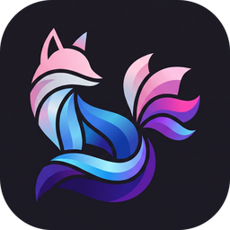
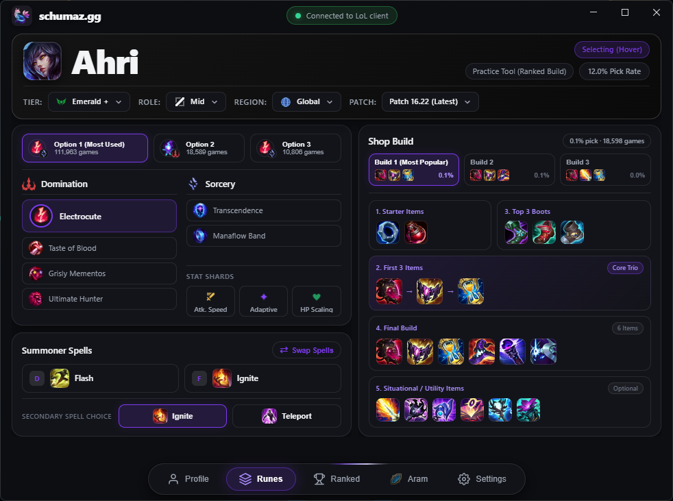
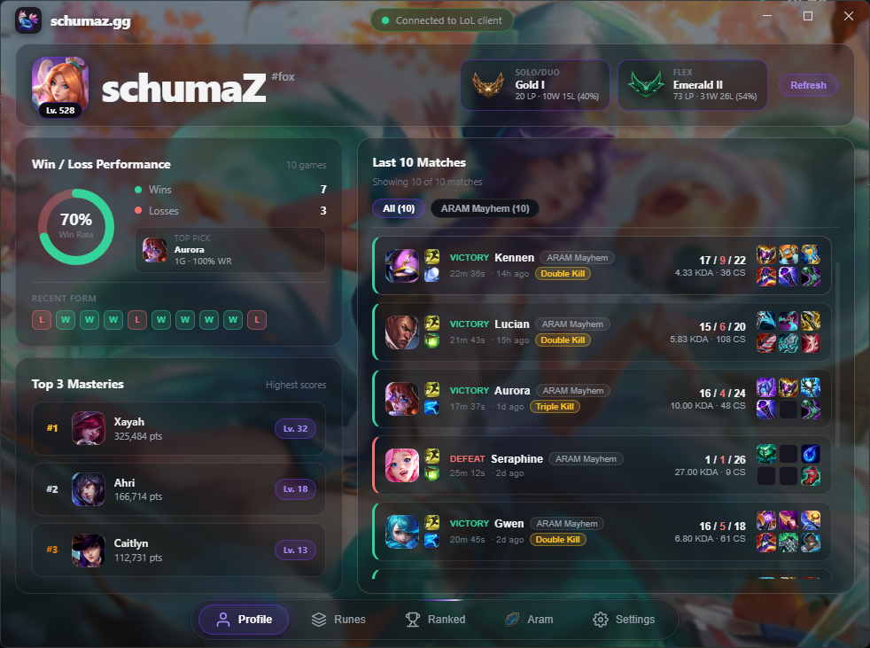
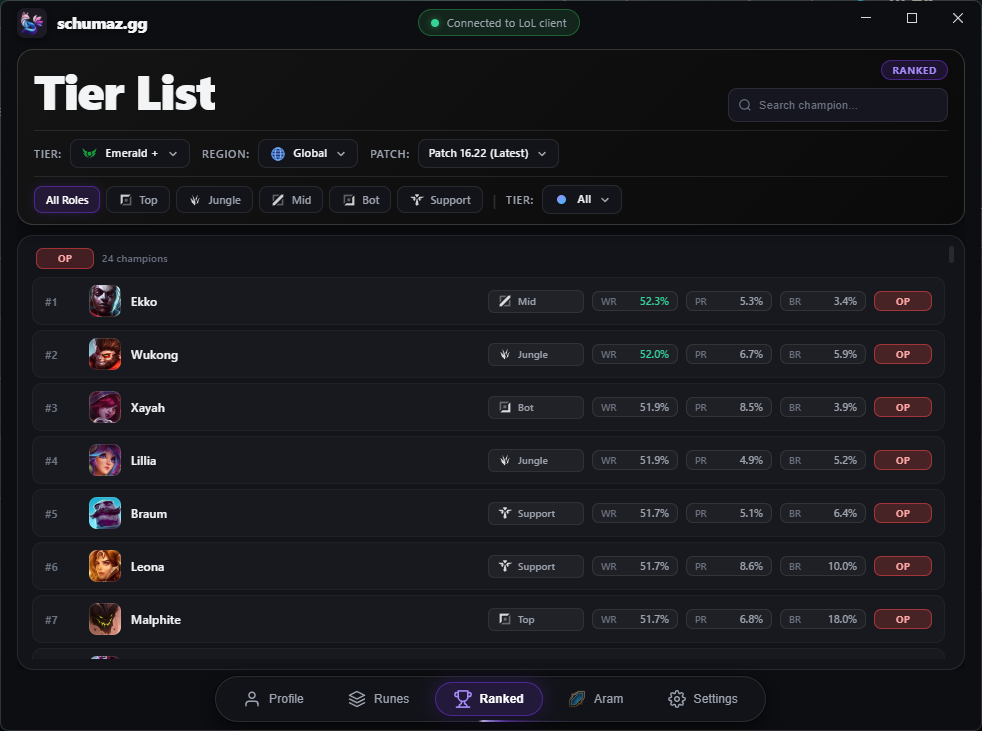
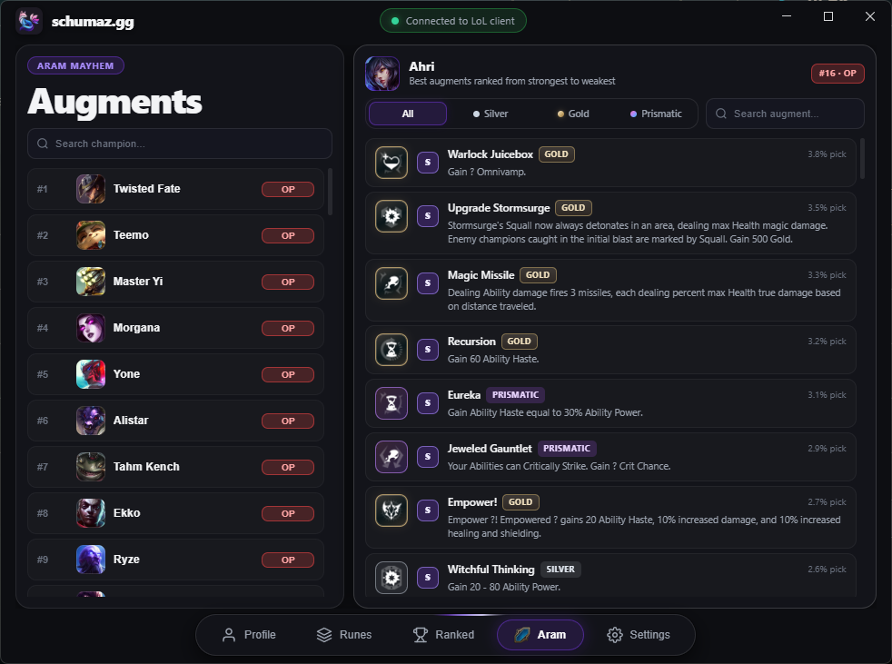
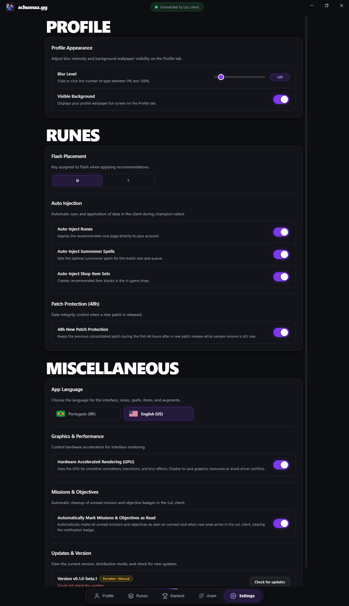

<p align="center">
  
</p>
<h1 align="center">schumaz.gg</h1>
<p align="center">
  <strong>Automated League of Legends Companion App.</strong> schumaz.gg detects Champion Select in the League client
  and applies OP.GG runes, summoner spells, and item sets automatically — alongside Ranked tier lists, ARAM &amp;
  ARAM Mayhem builds, and summoner profile analytics. Free and open source, for Windows.
</p>

<p align="center">
  <a href="https://github.com/schumaz/schumaz.gg/releases/latest"></a>
  <a href="https://github.com/schumaz/schumaz.gg/releases"></a>
  <a href="LICENSE"></a>
  
  
</p>

<p align="center">
  <a href="https://github.com/schumaz/schumaz.gg/releases/latest">Download</a>
  ·
  <a href="#features">Features</a>
  ·
  <a href="#install">Install</a>
  ·
  <a href="#how-to-use-it">How to use</a>
  ·
  <a href="#faq">FAQ</a>
  ·
  <a href="https://github.com/schumaz/schumaz.gg/issues/new">Report a bug</a>
</p>

<p align="center">
  <strong>English</strong> · <a href="README.pt-BR.md">Português (BR)</a>
</p>

> [!NOTE]
> **Riot Games Non-Endorsement Notice:** schumaz.gg isn't endorsed by Riot Games and doesn't reflect the views or
> opinions of Riot Games or anyone officially involved in producing or managing Riot Games properties. Riot Games, and
> all associated properties are trademarks or registered trademarks of Riot Games, Inc.

> [!WARNING]
> The only official downloads are this repository's [Releases](https://github.com/schumaz/schumaz.gg/releases).

<p align="center">
  
</p>

## Why

During Champion Select you shouldn't have to alt-tab to a browser or fight a bloated overlay just to copy runes and
items before the timer runs out. schumaz.gg connects directly to the League of Legends client, pulls consolidated build
data from OP.GG and DataDragon, and applies your runes, summoner spells, and shop item sets automatically in seconds.

I built schumaz.gg out of personal frustration. Over the years I tried several Electron-based League companions, and
**every single one of them had the exact same problems**: sluggish interfaces, noticeable FPS drops and worse 1% lows
in-game, slow rune injection in Champion Select, and high RAM usage just sitting in the background. By building
schumaz.gg with **Rust** and **Tauri v2** (using the native Windows WebView2 runtime instead of bundling another
Chromium instance), the app stays fast, lightweight, and out of your way while you play.

schumaz.gg is an **open-source, free, and strictly non-commercial** project created for **study, technical
experimentation, and personal use**. Its **public releases** are provided at no cost, with no ads, no paywalls, and no
telemetry.

## Features

- **Instant Champion Select & Swiftplay Lobby automation**: detects champion hover and lock-in in the League client across Summoner's Rift, ARAM, ARAM Mayhem, Arena, Clash (`700`), and **Swiftplay (`480`)** lobby pre-selection slots, with final pre-match safety reconciliation (including late ARAM bench swaps).
- **Configurable auto-injection**: independently toggle automatic application of **Runes**, **Summoner Spells** (with selectable top-2 spell pairs and **Flash on D or F** preference), and **5-block Shop Item Sets**.
- **Rich Build Intelligence**: DataDragon tooltips on items, runes, spells, and abilities, **Skill Order** priority (`Q > E > W`) with a `1–18` leveling grid, and **Lane Matchups** (*Hard* vs. *Favorable* opponents with lane win rates).
- **Ranked Tier List & Build Explorer**: browse champion tier lists and full builds filtered by **Tier/Elo**, **Role**, **Region** (15 servers + Global), and **Patch**.
- **ARAM & ARAM Mayhem**: explore full clickable **ARAM** builds alongside **ARAM Mayhem** champion builds and **Augments** rankings filterable by rarity (*Silver*, *Gold*, *Prismatic*, *Special*).
- **Summoner Profile 2.0**: view your summoner icon, level, client profile wallpaper, ranked emblems, full **Champion Mastery Catalog** modal, Win/Loss chart (excluding remakes), **paginated match history** with runes/augments/trinket (`item6`) and Arena placement, **on-demand 5v5 & Arena scoreboard drawers**, and one-click shortcuts to any champion's Ranked build.
- **48h New Patch Protection**: locks automatic selection to the previous consolidated patch for the first 48 hours
  after a new patch drops to avoid noisy low-sample builds (can be overridden manually in the filter bar or disabled in
  Settings).
- **Fast local cache & low footprint**: binary cache compressed with LZ4 + MessagePack, automatic cache cleanup,
  adaptive idle polling, System Tray with optional full WebView2 unloading during matches, and an option to disable GPU
  effects.
- **Quality of life**: optional Start with Windows, automatic cleanup of unread mission/objective badges in the League
  client, bilingual UI (**English** and **Português BR**), local sanitized diagnostic logs with one-click summary copy,
  and silent background auto-updates that wait until your match ends before downloading.

## Install

| Requirement | |
|---|---|
| OS | Windows 10 or 11, 64-bit |
| Game | League of Legends client installed |

Download one of the two builds from [Releases](https://github.com/schumaz/schumaz.gg/releases/latest):

- **Installer (`schumaz.gg_<version>_x64-setup.exe`)**: installs for your user only (`currentUser`), needs no admin
  rights, supports English and Portuguese (BR) in the wizard, and updates itself automatically in the background.
- **Portable (`schumaz.gg_<version>_x64-portable.exe`)**: single standalone executable with no installation required.
  Notifies you when a new version is available on GitHub for manual download.

<!-- UNSIGNED NOTICE: delete this block once releases are signed with an EV/OV certificate. -->
> [!IMPORTANT]
> **Windows executables aren't Authenticode-signed yet**, so the first run will likely trigger Windows SmartScreen
> ("Windows protected your PC"). Click **More info**, then **Run anyway**. To verify any download, compare its
> SHA-256 hash against `SHA256SUMS.txt` in the release notes (PowerShell: `Get-FileHash <file>`).
<!-- END UNSIGNED NOTICE -->

## How to use it

1. **Open schumaz.gg.** On first launch, pick your language (`English` or `Português`) and your Flash key (`D` or `F`).
2. **Launch the League of Legends client.** The top status badge turns green once connected, and the **Profile** tab
   syncs your account data automatically.
3. **Queue up (or browse Ranked / ARAM beforehand).** As soon as you hover or lock in a champion in Champion Select,
   schumaz.gg loads the build and injects runes, summoner spells, and item sets according to your preferences.

<p align="center">
  
  
</p>

<p align="center">
  
</p>

<details>
  <summary><strong>Preview the Settings screen</strong> (Flash placement, auto-injection toggles, 48h patch protection, language, GPU &amp; updates)</summary>
  <p align="center">
    
  </p>
</details>

## FAQ

**Can I get banned? Is it safe with Riot Vanguard?**  
schumaz.gg only communicates through the local League Client API (LCU — REST & WebSocket). It never reads or writes game
process memory, never injects DLLs, never modifies game files, and performs zero in-game automation. Even so, as with
any third-party companion tool, you use it at your own discretion.

**Where does it get builds and game data from?**  
Build statistics, tier lists, and ARAM Mayhem augment rankings come from OP.GG and the official OP.GG MCP server, while
all localized metadata and visual assets (champions, runes, spells, items, augments, and rank crests) come from Riot's
DataDragon and CommunityDragon. Data is normalized locally and stored in a **persistent on-disk cache validated by
patch/version** to minimize external traffic and keep the app responsive even during temporary upstream hiccups.

**What does it write, and where?**  
All settings, local caches, and diagnostic logs are stored in `%LOCALAPPDATA%\schumazgg\`:
- `Config\UserSettings.ini` — your preferences, window bounds, and saved filters
- `Cache\` (`ddragon\`, `opgg\`, `profile\`, `assets\`) — compressed local caches with automatic cleanup for stale files
- `Logs\` (`schumazgg.log`, `schumazgg.log.1`) — rotating local diagnostic logs (capped at 2 MiB, sanitized of credentials and user paths, never sent anywhere)
- `WebView\` — WebView2 user data

League of Legends installation files are never touched.

**Do I need an account?**  
No. Everything runs locally on your PC, with no login, no ads, and no telemetry.

**Something broke or a build looks wrong.**  
Open **Settings → System & Storage → Support & Diagnostics**, click **Copy diagnostic summary**, and paste it into a
new [issue](https://github.com/schumaz/schumaz.gg/issues/new) along with details about the champion and queue.

## Build from source

Prerequisites: Node.js (LTS), Rust (MSVC toolchain on Windows), and the standard Tauri v2 Windows prerequisites (MSVC
C++ build tools and WebView2):

```powershell
# Install frontend dependencies
npm install

# (Optional) Install cargo-sweep for automatic cleanup of old src-tauri\target artifacts
cargo install cargo-sweep --locked

# Run in development mode (auto-sweeps src-tauri\target if it exceeds 6 GiB)
npm run tauri dev

# Manually trim old Rust artifacts without recompiling active dependencies
npm run tauri:sweep

# Build Windows NSIS installer + Portable executable into dist-release\
npm run build:desktop -- --no-sign
```

Useful documentation: [ARCHITECTURE.md](ARCHITECTURE.md).

## Licence & Legal

Licensed under **GPL-3.0-only** ([LICENSE](LICENSE)). In accordance with the licence, this software is provided **"AS
IS"**, without warranty of any kind and with no guarantee of continuous availability or compatibility if third-party
APIs or services change or become unavailable.

schumaz.gg isn't endorsed by Riot Games and doesn't reflect the views or opinions of Riot Games or anyone officially
involved in producing or managing Riot Games properties. Riot Games, League of Legends, and all associated properties
are trademarks or registered trademarks of Riot Games, Inc.

- **Third-party non-affiliation & trademarks:** schumaz.gg is an independent project and is not affiliated with,
  endorsed by, or sponsored by **OP.GG** or **CommunityDragon**. All third-party names, logos, and trademarks remain
  the property of their respective owners.
- **100% local execution:** schumaz.gg runs entirely on your computer and queries public data sources directly from
  your client. There is no intermediary backend server operated by this project redistributing, hosting, or reselling
  third-party data.
- **Good-faith contact & takedown:** If you are a rights holder or data provider and have any concern regarding how
  schumaz.gg accesses, caches, or displays your data or assets, please reach out directly at
  **`schumaz.business@gmail.com`** (or open a [GitHub Issue](https://github.com/schumaz/schumaz.gg/issues/new)) for
  prompt review and action.

### Forks

Forks are welcome under the GPL-3.0 licence. If you distribute a fork, please give it a distinct name, clarify that it
is unofficial, and keep the original copyright and licence notices. Official builds are published exclusively on this
repository's [Releases](https://github.com/schumaz/schumaz.gg/releases) page.
