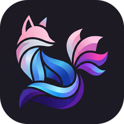
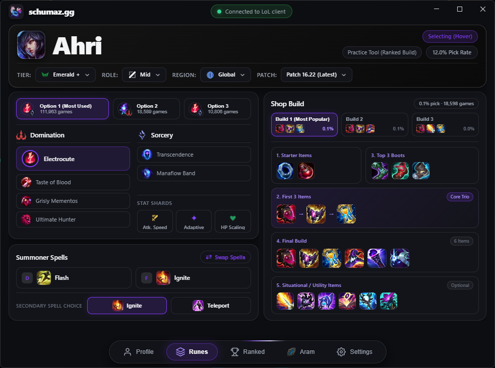
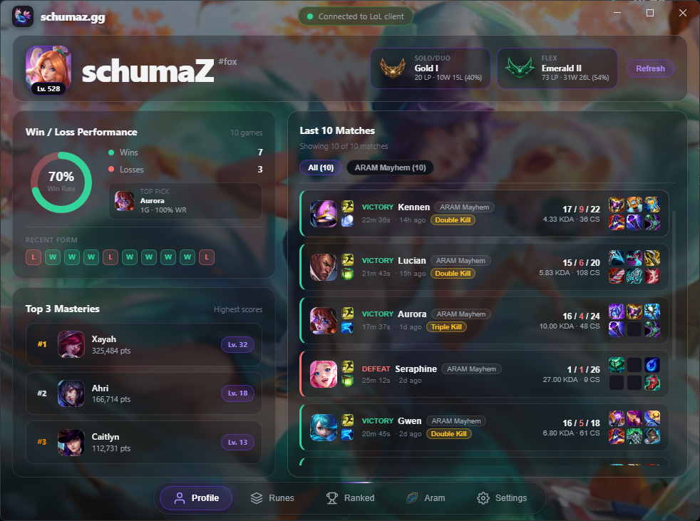
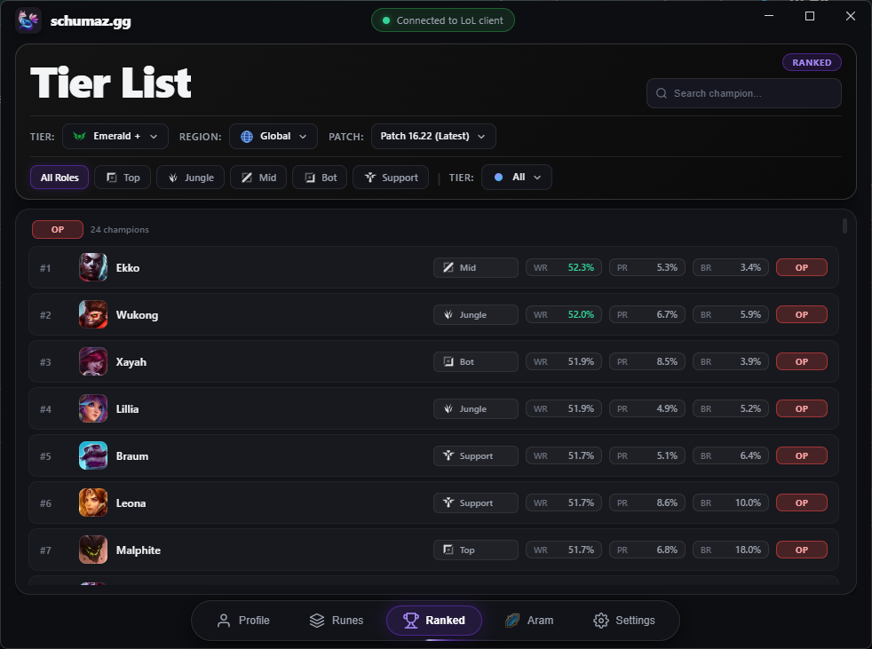
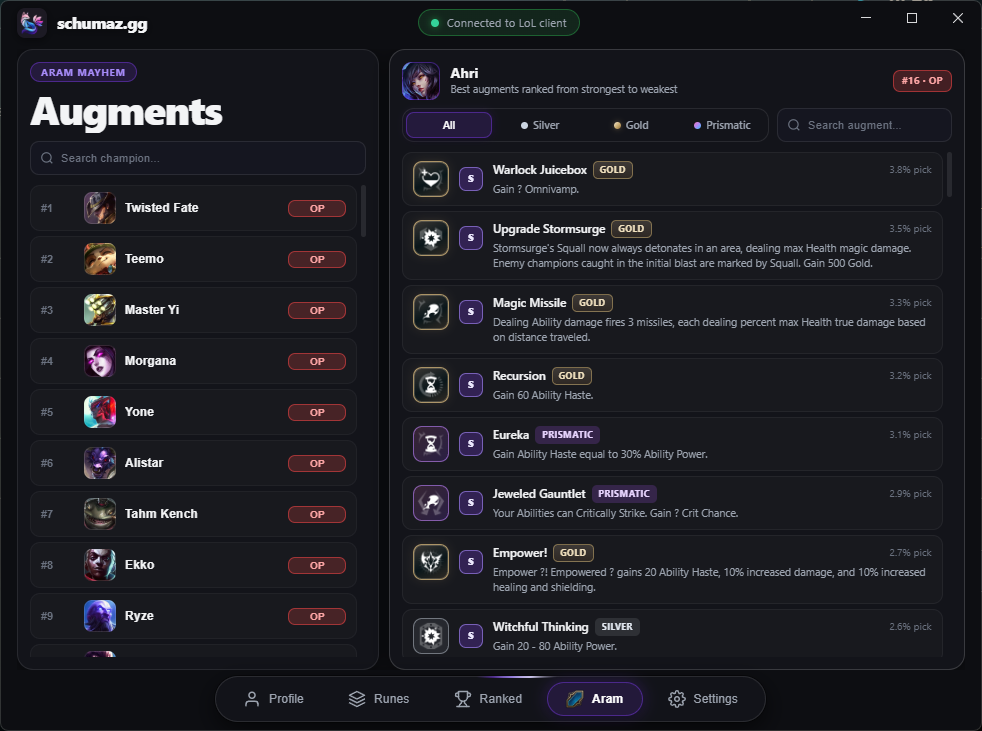
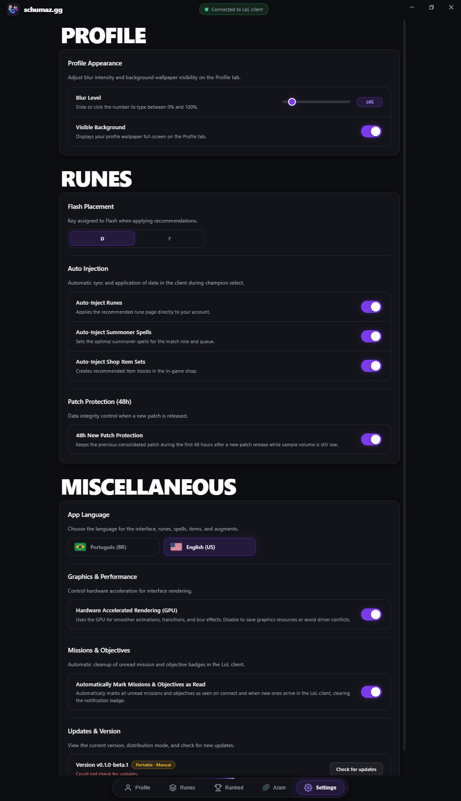

<p align="center">
  
</p>
<h1 align="center">schumaz.gg</h1>
<p align="center">
  <strong>Companion App Automatizado para League of Legends.</strong> O schumaz.gg detecta a Seleção de Campeões no
  cliente do LoL e aplica automaticamente runas, feitiços de invocador e conjuntos de itens do OP.GG — além de
  oferecer tier lists Ranqueadas, builds de ARAM &amp; ARAM Desordem (Mayhem) e análise do perfil de invocador. Gratuito
  e de código aberto, para Windows.
</p>

<p align="center">
  <a href="https://github.com/schumaz/schumaz.gg/releases/latest"></a>
  <a href="https://github.com/schumaz/schumaz.gg/releases"></a>
  <a href="LICENSE"></a>
  
  
</p>

<p align="center">
  <a href="https://github.com/schumaz/schumaz.gg/releases/latest">Download</a>
  ·
  <a href="#funcionalidades">Funcionalidades</a>
  ·
  <a href="#instalação">Instalação</a>
  ·
  <a href="#como-usar">Como usar</a>
  ·
  <a href="#faq">FAQ</a>
  ·
  <a href="https://github.com/schumaz/schumaz.gg/issues/new">Reportar um bug</a>
</p>

<p align="center">
  <a href="README.md">English</a> · <strong>Português (BR)</strong>
</p>

> [!NOTE]
> **Aviso de Não-Endosso da Riot Games:** schumaz.gg isn't endorsed by Riot Games and doesn't reflect the views or
> opinions of Riot Games or anyone officially involved in producing or managing Riot Games properties. Riot Games, and
> all associated properties are trademarks or registered trademarks of Riot Games, Inc.

> [!WARNING]
> Os únicos downloads oficiais estão na página de [Releases](https://github.com/schumaz/schumaz.gg/releases) deste
> repositório.

<p align="center">
  
</p>

## Por que existe

Durante a Seleção de Campeões você não deveria precisar ficar dando Alt+Tab para o navegador nem brigar com um overlay
pesado só para copiar runas e itens antes de o tempo acabar. O schumaz.gg conecta-se diretamente ao cliente do League of
Legends, busca os dados consolidados de build no OP.GG e DataDragon e aplica suas runas, feitiços e conjuntos de itens
na loja automaticamente em segundos.

Criei o schumaz.gg por frustração própria. Ao longo dos anos usei vários companions de LoL feitos em Electron, e **todos
eles tinham exatamente os mesmos problemas**: interfaces lentas, queda perceptível de FPS e piora no *1% low* dentro da
partida, demora para aplicar as runas no Champ Select e alto consumo de memória RAM só de ficarem abertos em segundo
plano. Ao construir o schumaz.gg com **Rust** e **Tauri v2** (usando o WebView2 nativo do Windows em vez de embutir
outra instância inteira do Chromium), o aplicativo permanece rápido, leve e fora do caminho enquanto você joga.

O schumaz.gg é um projeto **open-source, gratuito e estritamente não-comercial**, criado para **estudo, experimentação
técnica e uso pessoal**. Suas **releases públicas** são disponibilizadas sem custos, sem anúncios, sem paywall e sem
telemetria.

## Funcionalidades

- **Automação instantânea no Champ Select e Lobby do Swiftplay**: detecta *hover* e confirmação (*lock-in*) em Summoner's Rift, ARAM, ARAM Desordem, Arena, Clash (`700`) e pré-seleção no lobby do **Jogo Rápido / Swiftplay (`480`)**, com reconciliação final de segurança antes de a partida começar (incluindo trocas no banco do ARAM).
- **Auto-injeção configurável**: ative ou desative de forma independente **Runas**, **Feitiços de Invocador** (com seleção dos top-2 pares e preferência de **Flash no D ou F**) e **Conjuntos de Itens** em 5 blocos na loja.
- **Inteligência Completa de Build**: tooltips ricos do DataDragon em itens, runas, feitiços e habilidades, **Ordem de Habilidades** (`Q > E > W` + grade `1–18`) e **Confrontos na Rota** (*Difíceis* vs. *Favoráveis* com taxa de vitória real).
- **Tier List Ranqueada & Explorador de Builds**: consulte a lista de tiers e builds completas filtradas por **Elo**, **Rota**, **Região** (15 servidores + Global) e **Patch**.
- **ARAM & ARAM Desordem (Mayhem)**: explore builds completas clicáveis no **ARAM** clássico e alterne entre **Augments** e **Build & Feitiços** no **ARAM Desordem** com filtro por raridade (*Prata*, *Ouro*, *Prismático*, *Especial*).
- **Perfil do Invocador 2.0**: visualize ícone, nível, papel de parede do perfil, elos, catálogo completo de **Maestrias**, gráfico de Vitórias/Derrotas (excluindo *Remakes*), **histórico paginado** com runas/augments/amuleto (`item6`) e colocação na Arena, **placar completo 5v5 e Arena sob demanda** e atalhos diretos para a build do campeão na Ranqueada.
- **Proteção de Novo Patch (48h)**: trava a seleção automática no patch anterior já consolidado durante as primeiras
  48 horas após o lançamento de um novo patch para evitar builds com baixa amostragem (pode ser ignorada manualmente no
  seletor de patch ou desativada nas Configurações).
- **Cache local rápido e baixo consumo**: cache binário comprimido com LZ4 + MessagePack, limpeza automática de arquivos
  antigos, polling adaptativo em idle, bandeja do sistema com descarga opcional do WebView2 durante partidas e opção para
  desativar efeitos de GPU.
- **Qualidade de vida**: opção de Iniciar com o Windows, limpeza automática opcional das notificações de missões e
  objetivos não lidos no cliente do LoL, interface bilíngue (**Português BR** e **English**), logs locais sanitizados
  com cópia rápida de diagnóstico e atualizações silenciosas em segundo plano que aguardam sua partida terminar antes
  de baixar.

## Instalação

| Requisito | |
|---|---|
| Sistema | Windows 10 ou 11, 64 bits |
| Jogo | Cliente do League of Legends instalado |

Baixe uma das duas opções na página de [Releases](https://github.com/schumaz/schumaz.gg/releases/latest):

- **Instalador (`schumaz.gg_<versão>_x64-setup.exe`)**: instala apenas para o seu usuário (`currentUser`), não exige
  permissões de administrador, possui assistente em Português (BR) e Inglês e atualiza automaticamente em segundo plano.
- **Portátil (`schumaz.gg_<versão>_x64-portable.exe`)**: executável único sem instalação. Avisa quando houver uma nova
  versão no GitHub para você baixar manualmente.

<!-- UNSIGNED NOTICE: remova este bloco quando as releases forem assinadas com certificado EV/OV. -->
> [!IMPORTANT]
> **Os executáveis ainda não possuem assinatura digital (Authenticode)**, então a primeira execução provavelmente
> exibirá o aviso do Windows SmartScreen ("O Windows protegeu o computador"). Clique em **Mais informações** e depois em
> **Executar assim mesmo**. Para conferir a integridade do arquivo, compare o SHA-256 com o arquivo `SHA256SUMS.txt` da
> release (no PowerShell: `Get-FileHash <arquivo>`).
<!-- END UNSIGNED NOTICE -->

## Como usar

1. **Abra o schumaz.gg.** Na primeira abertura, escolha seu idioma (`Português` ou `English`) e sua tecla do Flash (`D`
   ou `F`).
2. **Abra o cliente do League of Legends.** O indicador no topo ficará verde assim que conectar, e a aba **Perfil**
   sincronizará sua conta automaticamente.
3. **Entre na fila (ou navegue por Ranqueada / ARAM antes).** Ao selecionar ou confirmar um campeão no Champion Select,
   o schumaz.gg carrega a build e aplica runas, feitiços e itens conforme as suas preferências.

<p align="center">
  
  
</p>

<p align="center">
  
</p>

<details>
  <summary><strong>Ver tela de Configurações</strong> (posição do Flash, auto-injeção, proteção de 48h, idioma, GPU e atualizações)</summary>
  <p align="center">
    
  </p>
</details>

## FAQ

**Posso tomar ban? É seguro com o Riot Vanguard?**  
O schumaz.gg se comunica exclusivamente através da API local do cliente do League of Legends (LCU — REST e WebSocket).
Ele nunca lê nem escreve na memória do processo do jogo, nunca injeta DLLs, nunca altera arquivos do jogo e não realiza
nenhuma automação dentro da partida. Ainda assim, como qualquer ferramenta de terceiros, o uso é por sua conta e risco.

**De onde vêm as builds e os dados?**  
Estatísticas de builds, tier lists e rankings de aprimoramentos do ARAM Desordem vêm do OP.GG e do servidor oficial
OP.GG MCP, enquanto todos os metadados localizados e ativos visuais (campeões, runas, feitiços, itens, aprimoramentos e
brasões de elo) vêm do DataDragon da Riot e do CommunityDragon. Os dados são normalizados localmente e mantidos em um
**cache persistente em disco validado por patch/versão** para minimizar o tráfego externo e manter o aplicativo
resiliente mesmo diante de instabilidades temporárias nos serviços externos.

**O que ele grava no meu PC e onde?**  
Todas as configurações, caches e logs locais ficam centralizados em `%LOCALAPPDATA%\schumazgg\`:
- `Config\UserSettings.ini` — suas preferências, posição/tamanho da janela e filtros salvos
- `Cache\` (`ddragon\`, `opgg\`, `profile\`, `assets\`) — caches locais comprimidos com limpeza automática para arquivos antigos
- `Logs\` (`schumazgg.log`, `schumazgg.log.1`) — logs locais rotativos de diagnóstico (teto de 2 MiB, sanitizados sem credenciais nem caminhos de usuário, nunca enviados externamente)
- `WebView\` — dados do runtime WebView2

Os arquivos de instalação do League of Legends nunca são modificados.

**Preciso criar conta?**  
Não. Tudo roda localmente no seu PC, sem login, sem anúncios e sem telemetria.

**Algo quebrou ou uma build parece incorreta.**  
Acesse **Configurações → Sistema e Armazenamento → Suporte e Diagnóstico**, clique em **Copiar resumo de diagnóstico** e
cole o resultado ao abrir uma [issue](https://github.com/schumaz/schumaz.gg/issues/new) junto com o campeão e a fila.

## Compilar do zero (Build from source)

Pré-requisitos: Node.js (LTS), Rust (toolchain MSVC no Windows) e os pré-requisitos padrão do Tauri v2 no Windows
(ferramentas de build C++ do MSVC e WebView2):

```powershell
# Instalar dependências do frontend
npm install

# (Opcional) Instalar cargo-sweep para limpeza automática de artefatos antigos em src-tauri\target
cargo install cargo-sweep --locked

# Executar em modo de desenvolvimento (limpa automaticamente src-tauri\target se passar de 6 GiB)
npm run tauri dev

# Limpar manualmente artefatos antigos sem recompilar dependências ativas
npm run tauri:sweep

# Gerar instalador NSIS + executável Portátil em dist-release\
npm run build:desktop -- --no-sign
```

Documentação útil: [ARCHITECTURE.md](ARCHITECTURE.md).

## Licença e Avisos Legais

Licenciado sob **GPL-3.0-only** ([LICENSE](LICENSE)). Conforme os termos da licença, este software é distribuído
**"COMO ESTÁ" (*"AS IS"*)**, sem garantias de qualquer natureza e sem compromisso de disponibilidade contínua ou
compatibilidade caso APIs ou serviços de terceiros sejam alterados ou descontinuados.

schumaz.gg isn't endorsed by Riot Games and doesn't reflect the views or opinions of Riot Games or anyone officially
involved in producing or managing Riot Games properties. Riot Games, League of Legends, and all associated properties
are trademarks or registered trademarks of Riot Games, Inc.

- **Não-afiliação e marcas de terceiros:** o schumaz.gg é um projeto independente e não é afiliado, endossado nem
  patrocinado pelo **OP.GG** ou pelo **CommunityDragon**. Todos os nomes, logotipos e marcas de terceiros pertencem aos
  seus respectivos titulares.
- **Execução 100% local:** o schumaz.gg roda integralmente no seu computador, consultando as fontes de dados
  diretamente a partir da máquina do usuário. Não existe nenhum servidor intermediário operado por este projeto
  redistribuindo, hospedando ou comercializando dados de terceiros.
- **Contato de boa-fé (*good-faith takedown/contact*):** caso você seja titular de direitos ou provedor de dados e
  tenha qualquer solicitação relacionada à forma como o schumaz.gg acessa, armazena em cache ou exibe seus dados ou
  ativos, entre em contato diretamente pelo e-mail **`schumaz.business@gmail.com`** (ou abra uma
  [GitHub Issue](https://github.com/schumaz/schumaz.gg/issues/new)) para atendimento imediato.

### Forks

Forks são bem-vindos sob a licença GPL-3.0. Se você distribuir um fork, dê a ele um nome próprio, deixe claro que não é
oficial e mantenha os avisos originais de copyright e licença. Os builds oficiais são publicados exclusivamente na página
de [Releases](https://github.com/schumaz/schumaz.gg/releases) deste repositório.
